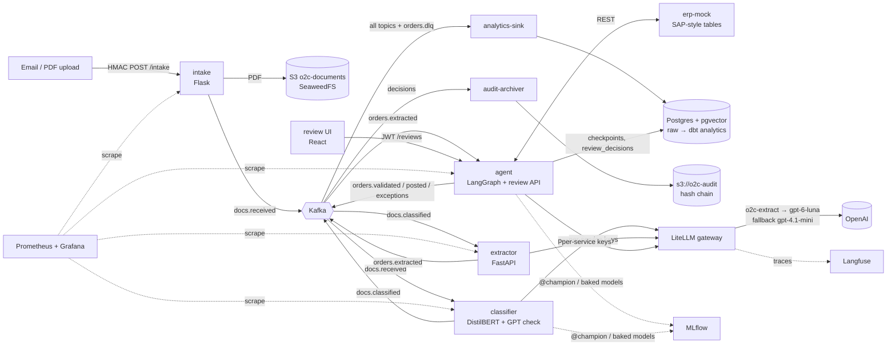
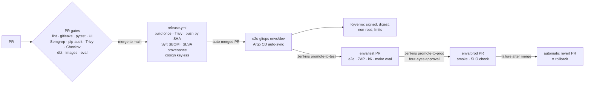

# Order-to-Cash Agent

An AI agent that turns emailed purchase-order PDFs into ERP sales orders:
- **Intake.** An HMAC-signed webhook stores each PDF.
- **Classification.** A fine-tuned DistilBERT classifies it, and a GPT double-check
  confirms every purchase order.
- **Extraction.** An LLM behind a LiteLLM gateway extracts the order.
- **Validation and posting.** A LangGraph agent checks every value against the ERP with
  explicit rules. It posts clean orders itself and sends everything else to a human
  review UI.

The LLM never decides whether an order is posted: code does. Every decision lands in a
hash-chained audit archive. Every image that runs is signed, attested and admitted by
policy, and every release goes Dev → Test → Prod through Git, evaluation gates and
four-eyes approval.

This is a portfolio project: synthetic data, run locally (Docker Compose, kind, Jenkins);
the AWS part (E3) is planned.

## Architecture



| Topic | Producer → consumer | Retention |
|---|---|---|
| `docs.received` | intake → classifier | 7 d |
| `docs.classified` | classifier → extractor | 7 d |
| `orders.extracted` | extractor → agent | 7 d |
| `orders.validated` | agent → audit, analytics | 7 d |
| `orders.exceptions` / `orders.posted` | agent → audit, analytics (ServiceNow E13, CRM E12 planned) | 30 d |
| `orders.dlq` | any consumer → `make dlq-replay` | 30 d |

Every consumer is idempotent (`o2c_common.kafka.EventConsumer`, idempotency key = message
key). Each environment prefixes its topics (`dev.docs.received`, ADR-017).

## Delivery



## Key results
All on synthetic data. Sources: the ADRs and epic guides, and `make eval` of 2026-10-28.

| Area | Result | Source |
|---|---|---|
| Extraction, golden set (50 POs) | 50/50 perfect POs, 100% field accuracy (gpt-6-luna) | ADR-008, `make eval` 2026-10-28 |
| Extraction, held-out (20 harder POs) | 10 to 14/20 perfect, 99.1 to 99.5% fields across runs (11/20, 99.19% on 2026-10-28). Errors are `customer_number` only, verified in code against the ERP. | ADR-005, ADR-008 |
| Model migration | gpt-4.1-mini → gpt-6-luna by a noise-aware rule plus a full gate: 65 to 70% cheaper per PO ($0.00035) | ADR-008 |
| Document classifier | DistilBERT v3 alone 100% vs GPT 97.5% on the 40-doc held-out. The hybrid sends 25% to GPT: 100%, 0 false POs, 418 ms and $0.11 per 1000 docs (GPT only: 1,192 ms, $0.30). | ADR-005, ADR-009 |
| Quantity anomaly | False alarms on normal POs 92.9% → 2.9% (held-out 0%); recall 90.2% | ADR-006 |
| Explanations (LLM-as-judge) | 14/14 pass after one prompt rule (was 12/14); judge validated 7/7 first | ADR-010 |
| Red team | 6/8 → **8/8** (hidden text, injected instructions, customer mix-up, price and quantity attacks) | ADR-010 |
| Injection detector | 0 false positives on 720 legitimate documents | ADR-010 |
| Evaluation gate | 13/13 checks PASS, $0.11 per full run | `eval/report.md` |
| Cost per order | $0.00121 average LLM cost | ADR-013 |
| CI gates | Every gate proven red on a planted fault; found a gitleaks gap and fixed it | `docs/gates-evidence.md` |
| Promotion | promote-to-test: e2e, ZAP, k6 p95 8.5 ms, eval PASS. promote-to-prod: four-eyes, SLO p95 53.6 ms. 2 automatic rollbacks. | ADR-018 |
| Audit | Hash chain intact (68 entries); 8/8 prod images signature- and attestation-verified | `make audit-check` 2026-10-28 |

## Run locally
Prerequisites: Windows with Docker Desktop and Git Bash (see `docs/epics/E2 ...`), uv,
pnpm, and an `.env` from `.env.example` with an OpenAI key.

```bash
make sync                      # Python workspace (uv)
make up                        # Postgres, Kafka, SeaweedFS, MLflow, LiteLLM, Langfuse, services, UI
make buckets && make topics    # once per fresh stack
make erp-migrate && make erp-seed && make erp-seed-history
uv run python -m agent.auth add-user reviewer1 "Review Er"   # a reviewer login
make send PDF=poc/data/pos/PO-0002.pdf                       # a PO with a price deviation
```
Then open the review UI at **http://localhost:5180**. Also available:

| Tool | URL |
|---|---|
| Grafana | http://localhost:3001 |
| Langfuse | http://localhost:3000 |
| MLflow | http://localhost:5000 |
| Agent API | http://localhost:8400/docs |

Quality and audit:
```bash
make test && make ui-test && make lint
make eval-quick                # ~1.5 min, ~$0.02;  make eval: full gate, ~10 min, ~$0.11
make audit-check               # signatures of what runs, promotion history, Jenkins trail, audit chain
```
All commands are listed in [CLAUDE.md](CLAUDE.md).

## Repositories
| Repo | Holds |
|---|---|
| **o2c-app** (this) | Services (`services/`), shared library (`libs/o2c-common`), UI (`ui/`), prompts, ML pipelines and evaluations (`ml/`), dbt (`analytics/`), observability, ADRs |
| [o2c-infra](https://github.com/abhinavsingh-a1/o2c-infra) | Helm chart `o2c-service`, kind platform (Argo CD, Kyverno), Jenkins via Ansible with the promotion pipelines, Terraform (AWS audit module, not applied) |
| [o2c-gitops](https://github.com/abhinavsingh-a1/o2c-gitops) | What runs where: `envs/<env>/<service>.yaml` for dev, test and prod (image digests), Argo CD apps, Kyverno policies |

```
services/   intake · classifier · extractor · agent · erp-mock · analytics-sink · audit-archiver
libs/o2c-common/   events, Kafka consumer/producer, metrics, PDF text, injection detector
ml/         training, evaluations (eval_gate, judge, red team), MLflow/Langfuse/LiteLLM tools
prompts/    every LLM prompt (CODEOWNERS)
analytics/dbt/   raw → staging → analytics marts
observability/   Prometheus rules, Grafana dashboards as code
scripts/    verify_image.sh, audit_check.sh, promotion helpers
```

## Documentation
- **Decisions:** [docs/adr/](docs/adr/). ADR-001 three repos · 002 PoC · 003 events ·
  004 agent graph · 005 no OpenAI fine-tuning · 006 anomaly model · 007 Kubeflow ·
  008 model migration · 009 hybrid classifier · 010 evaluation and red team ·
  011 LiteLLM keys · 012 observability · 013 analytics · 014 audit trail · 015 CI gates ·
  016 supply chain · 017 GitOps platform · 018 promotion pipelines.
- **Governance:** [docs/governance/](docs/governance/). Each file is a self-assessment,
  not legal advice:
  - [EU AI Act](docs/governance/eu-ai-act.md)
  - [DPIA](docs/governance/dpia.md)
  - [model cards](docs/governance/model-cards/)
  - [AI register](docs/governance/ai-register.md)
  - [risk register](docs/governance/risk-register.md)
  - [human oversight](docs/governance/human-oversight.md)
  - [threat model](docs/governance/threat-model.md)
- **Operations:** [docs/operations/](docs/operations/):
  - [runbooks](docs/operations/runbooks.md)
  - [SLOs](docs/operations/slos.md)
  - [DR plan](docs/operations/dr-plan.md)
- **Evidence:** [gates evidence](docs/gates-evidence.md); the epic guides in
  [docs/epics/](docs/epics/).
- **Security policy:** [SECURITY.md](SECURITY.md). **History:** [CHANGELOG.md](CHANGELOG.md).

## License
See [LICENSE](LICENSE).
