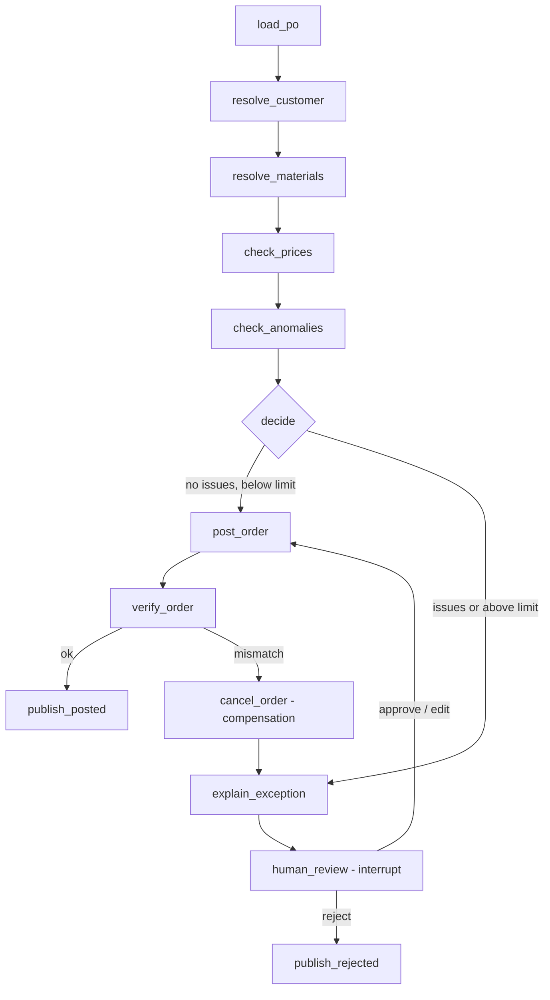

# ADR-004: Order validation agent as a LangGraph state machine

Date: 2026-10-20
Status: Accepted

## Context
Extracted POs must be validated against the ERP and posted, or handed to a human.
The agent creates real sales orders, so every path must be predictable, auditable
and safe to resume after a crash.

## Decision
A fixed LangGraph graph, not a free-form tool-calling agent:

Rules:
- Deterministic code does all checks and arithmetic. The LLM is used only to
  match a line without material number to a material (when ERP search is ambiguous),
  to read contract tolerances (RAG), and to explain exceptions in plain language.
- Auto-post only when there are no issues and the order total is below a configurable
  limit (default 10,000 EUR). Everything else goes to a human.
- State is checkpointed in Postgres after every node; the thread id is the
  document's idempotency key, so a crashed run resumes where it stopped.
- The ERP API is idempotent on the same key, so re-running post_order is safe.
- verify_order reads the order back; on mismatch, cancel_order compensates (saga).

Issue codes: UNKNOWN_CUSTOMER, UNKNOWN_MATERIAL, NO_AGREED_PRICE, PRICE_DEVIATION,
QUANTITY_ANOMALY, TOTAL_MISMATCH, ORDER_VERIFY_FAILED, ABOVE_AUTO_POST_LIMIT,
APPROVAL_NOT_POSSIBLE, CUSTOMER_MISMATCH, PROMPT_INJECTION_SUSPECTED.

Customer resolution (resolve_customer; ADR-005, extended in E11 after red-team case RT-05,
ADR-010):
- A printed customer number is used only if the ERP customer with that number has the
  printed name.
- Otherwise the customer is resolved by name. If the printed number belongs to a
  *different* ERP customer, the issue CUSTOMER_MISMATCH is raised as well, so the order
  goes to review: a real customer's number next to another customer's name is a mix-up or
  fraud signal. Before E11 this case was posted silently.
- A printed number that does not exist in the ERP (e.g. our supplier number at the
  customer, "formular" layout) is still ignored without an issue.

Prompt injection (decide; ADR-010): the extractor puts o2c_common.injection findings into
orders.extracted (`injection_findings`). If there are any, decide raises
PROMPT_INJECTION_SUSPECTED, so the order always goes to a human. After an edit the
findings stay, so the order comes back to review; approve posts it.

Human review (implemented):
- human_review pauses with interrupt(); the decision resumes the run via Command(resume=...).
- approve posts as-is (refused if customer or material is unknown); edit re-runs all checks
  on the corrected PO; reject ends with status rejected.
- A decision for an order that is not waiting is refused.
- The exception explanation is written by GPT; on failure the issue list is used instead.

## Consequences
- Every possible path is visible and testable node by node.
- Human review is a first-class step (EU AI Act: human oversight).
- Less flexible than a free agent; new behaviour means a new node or edge.

## Finding: the saga caught a real ERP/agent inconsistency (E15, 2026-10-22)
Three orders ended in review with ORDER_VERIFY_FAILED (BP0052582 twice, SAT-014323;
found with `analytics.fct_orders`). Each had one line whose value ends in half a cent:
168.5 x 1.85 = 311.725 and 191.5 x 2.15 = 411.725.
- The agent and the PO round half-up (`_money`, ROUND_HALF_UP): 311.73, total 1856.13.
- The ERP mock used `Decimal.quantize` without a rounding mode, i.e. ROUND_HALF_EVEN:
  311.72, total 1856.12.

verify_order compared the ERP's net value with the PO total, found the one-cent
difference and cancel_order cancelled the sales orders (all three are CANCELLED in the
ERP). So the saga worked as designed: no order with a wrong total stayed open. The
cause was fixed in the ERP mock (`erp_mock.api.line_value`, ROUND_HALF_UP, tested with
half-cent cases).
- Lesson: every system that computes money must use the same rounding rule. A real
  ERP integration needs this checked against the ERP's pricing configuration; the
  verify step stays because it detects exactly this kind of drift.
