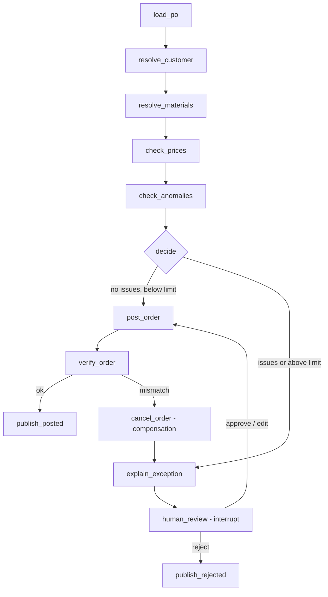

# ADR-004: Order validation agent as a LangGraph state machine

Date: 2026-10-20
Status: Accepted

## Context
Extracted POs must be validated against the ERP and posted, or handed to a human.
The agent creates real sales orders, so every path must be predictable, auditable
and safe to resume after a crash.

## Decision
A fixed LangGraph graph, not a free-form tool-calling agent:

Rules:
- Deterministic code does all checks and arithmetic. The LLM is used only to
  match a line without material number to a material (when ERP search is ambiguous),
  to read contract tolerances (RAG), and to explain exceptions in plain language.
- Auto-post only when there are no issues and the order total is below a configurable
  limit (default 10,000 EUR). Everything else goes to a human.
- State is checkpointed in Postgres after every node; the thread id is the
  document's idempotency key, so a crashed run resumes where it stopped.
- The ERP API is idempotent on the same key, so re-running post_order is safe.
- verify_order reads the order back; on mismatch, cancel_order compensates (saga).

Issue codes: UNKNOWN_CUSTOMER, UNKNOWN_MATERIAL, NO_AGREED_PRICE, PRICE_DEVIATION,
QUANTITY_ANOMALY, TOTAL_MISMATCH, ORDER_VERIFY_FAILED.

## Consequences
- Every possible path is visible and testable node by node.
- Human review is a first-class step (EU AI Act: human oversight).
- Less flexible than a free agent; new behaviour means a new node or edge.
