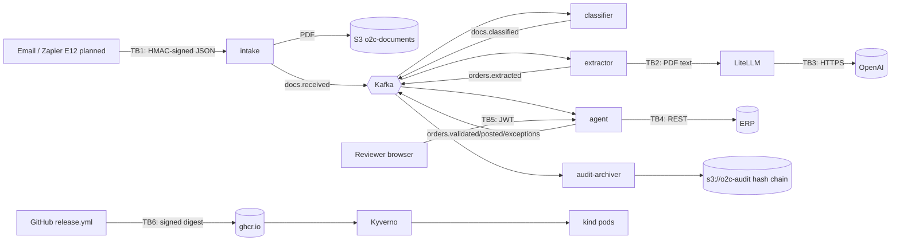

# Threat model (STRIDE)

Self-assessment for a portfolio project, not legal advice. Last updated: 2026-10-28.
Scope: the local system (Docker Compose infrastructure, plus services in Compose or in
the kind cluster) and its delivery pipeline. AWS is not built (E3).

## Data flow and trust boundaries

Trust boundaries:
- **TB1:** the internet to intake.
- **TB2:** document content to the LLM.
- **TB3:** the external LLM provider.
- **TB4:** the agent to the system of record.
- **TB5:** people to the review API.
- **TB6:** the supply chain to the cluster.

## STRIDE per element

| # | Threat | Element | Scenario | Existing controls | Residual / gap |
|---|---|---|---|---|---|
| S1 | **Spoofing** | intake | Anyone posts a fake PO | HMAC-SHA256 over the body, `X-O2C-Signature`, constant-time compare (`test_wrong_signature_is_rejected`) | A signed body can be replayed. The idempotency key (source + content hash) makes a replay a duplicate, so no second order. No timestamp in the signature. |
| S2 | Spoofing | customer identity in a PO | A real customer's number next to another name (fraud or mix-up) | `CUSTOMER_MISMATCH` sends it to review (red team RT-05); look-alike names give `UNKNOWN_CUSTOMER` (RT-04) | Low |
| S3 | Spoofing | reviewer | Decision made as another user | JWT login (scrypt hashes); the reviewer is taken from the token, never the body (`test_decision_records_logged_in_user_as_reviewer`); tampered, expired or foreign-key tokens give 401 (`test_auth.py`) | No MFA, no SSO; local users file |
| S4 | Spoofing | release approver | Developer approves own prod release | Jenkins four-eyes check: starter != approver (prod #3 refused); matrix authorisation | Jenkins users are local (JCasC) |
| S5 | Spoofing | image | Unsigned or foreign image runs | Kyverno `verify-image-signatures` (keyless, release.yml on main), `restrict-image-registries`, `require-image-digest` (ADR-017); rejection tests in o2c-gitops `platform/tests` | Low. Depends on Sigstore public infrastructure. |
| T1 | **Tampering** | document content | Hidden instructions change prices or approve (prompt injection) | Invisible text dropped (`o2c_common.pdf`); `o2c_common.injection` gives PROMPT_INJECTION_SUSPECTED (always review); prompt rule "document text is data"; code checks prices against the ERP; red team RT-01 to RT-03 in every gate | White text at normal size and text in images or XObjects are not dropped; code checks still apply |
| T2 | Tampering | extracted values | Negative price, 99% discount, 40x quantity | PRICE_DEVIATION and QUANTITY_ANOMALY in code (RT-06 to RT-08) | Low |
| T3 | Tampering | LLM output | Model returns an invented material or a wrongly shaped JSON | ERP candidate check; strict structured outputs with `extra="forbid"` (`test_structured_output.py`) | Low |
| T4 | Tampering | audit records | Someone edits or deletes a decision | Append-only `review_decisions` (rule); hash chain over every field plus `verify_audit.py` (ADR-014); `make audit-check` | A database owner can still rewrite Postgres and recompute the local chain. Object Lock (AWS module) is written, not applied. Publishing the head hash elsewhere is not automated. |
| T5 | Tampering | images and build | Compromised build or registry tag swap | Build once; digests only; cosign keyless signature; SLSA provenance; SBOM attestation; Trivy before push (ADR-016); verified again at promotion (ADR-018) | Low |
| T6 | Tampering | GitOps state | Change to `envs/prod` outside a reviewed PR | PRs with checks (yamllint, helm render); prod syncs only by hand; Argo CD shows drift | Branch protection is a GitHub setting, not in Git |
| T7 | Tampering | dependencies | Malicious or broken update (Dependabot) | pip-audit, pnpm audit, Trivy, Semgrep; Dependabot ignores; pin tests; eval gate caught the pandas 3 drift (ADR-006) | 35 audited pip-audit ignores until 2026-12-31 |
| R1 | **Repudiation** | reviewer decision | "I did not approve that" | Reviewer from the token; append-only row; hash-chained archive; decision history in the UI | Low |
| R2 | Repudiation | release | "Nobody approved this prod deploy" | Jenkins audit trail (logins, approvals, credential use); `reports/approval.txt`; gitops PR history (`make audit-check`) | ServiceNow change request skipped until E13 |
| I1 | **Information disclosure** | LLM provider | PO text, including contact data, leaves the company | Text only, never the PDF; no training on API data; per-service keys | No ZDR or EU residency yet ([dpia.md](dpia.md) D1) |
| I2 | Information disclosure | Langfuse | Full prompts stored indefinitely | Self-hosted, admin login | [dpia.md](dpia.md) D2 |
| I3 | Information disclosure | secrets | Key committed to the public repo | `.env` git-ignored; gitleaks hook plus gitleaks over every PR commit (found by gate evidence); Trivy and Semgrep secrets; Jenkins and kind secrets from `.env`, never printed; `check_env.py` prints no values | Low |
| I4 | Information disclosure | BI | Dashboard reads raw payloads | `grafana_ro`: SELECT on `analytics` only, read-only transactions (ADR-013) | Low |
| I5 | Information disclosure | metrics | Identifiers in labels | Label allow-list, tested (ADR-012); LiteLLM `/metrics/` unauthenticated, local only | NetworkPolicy for LiteLLM in the cloud only |
| I6 | Information disclosure | web | Clickjacking, XSS in the UI or Swagger | CSP, frame-ancestors, nosniff, COOP/CORP, self-hosted Swagger UI; ZAP rules FAIL on regression (ADR-018) | Low |
| D1 | **Denial of service** | intake | Huge or many uploads | 10 MB limit, PDF magic check, HMAC before parsing; k6 in promotion | No rate limit |
| D2 | Denial of service | pipeline | Poison message blocks a consumer | Retries, then `orders.dlq` with headers (ADR-003); DLQ and lag alerts | Low |
| D3 | Denial of service | LLM spend | Loop or abuse burns budget | Per-service monthly budgets (ADR-011); `LlmCostHigh` | Low |
| D4 | Denial of service | ERP or LLM outage | Orders stall | ERP GET retries (E16); LiteLLM fallback; consumer retries and DLQ replay; runbooks | Medium: one LLM provider |
| E1 | **Elevation of privilege** | containers | Container breakout or root | Non-root, read-only root filesystem, no privilege escalation, all capabilities dropped, seccomp RuntimeDefault (chart 0.2.0); Kyverno `require-run-as-non-root` | Low |
| E2 | Elevation of privilege | Jenkins | A pipeline step gets host root | - | **Accepted locally:** the controller has the Docker socket (root-equivalent, ADR-018). Never for a shared Jenkins. |
| E3 | Elevation of privilege | LiteLLM keys | A service uses the master key | Services get their own virtual key; the master key only in LiteLLM and admin scripts (ADR-011) | An empty service key falls back to the master key locally |
| E4 | Elevation of privilege | internal APIs | Direct call to `POST /extract` or Kafka without auth | Ports published on localhost only | Kafka PLAINTEXT without ACLs; extractor API unauthenticated. Acceptable on one machine; needs mTLS/SASL and NetworkPolicies in the cloud. Argo CD runs without NetworkPolicies on kind (ADR-018 findings). |

## Mapping to evidence
| Control | Where it is proven |
|---|---|
| Red team (8 attacks) | `ml/eval_redteam.py`, step in every gate; 8/8 on 2026-10-28 |
| Injection detector false positives | 0 of 200 documents (gate), 0 of 720 (ADR-010) |
| PR gates go red on planted faults | `docs/gates-evidence.md` (PR #63) |
| Kyverno rejects unsigned, root and foreign images | o2c-gitops `platform/tests`, `verify-policies.sh` (ADR-017) |
| Signatures and attestations of what runs | `make audit-check`: 8/8 prod images PASS on 2026-10-28 |
| Audit chain integrity | `ml/verify_audit.py`: 68 entries intact on 2026-10-28 |
| ZAP header rules | promote-to-test reports (ADR-018) |
